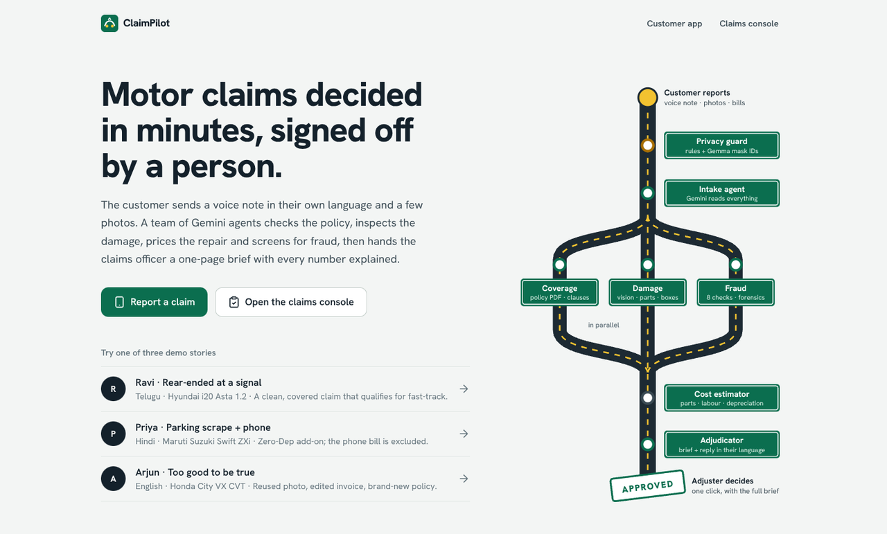
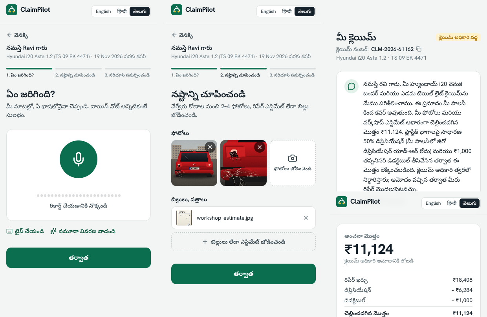
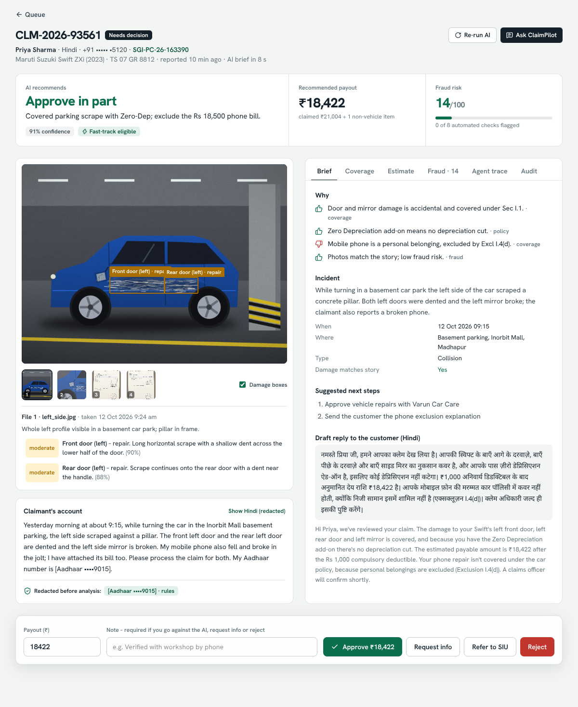

# ClaimPilot

**An AI claims desk for motor insurance, built on Google Cloud.**
Theme: BFSI (banking, financial services and insurance) · Google Cloud AI Builder Cup

A customer reports a car accident by voice note in Telugu, Hindi or English and adds a few photos and bills.
A team of Gemini agents built with Google's Agent Development Kit (ADK) then does the work a claims desk does today:

- reads the voice note, photos and bills;
- checks the policy and cites the exact clauses;
- inspects the damage and draws boxes on the photos;
- prices the repair with Indian depreciation rules;
- screens for fraud (reused photos, edited invoices, suspicious timing).

A human adjuster gets a one-page brief and decides with one click. The customer gets an answer in their own language.



| Customer app (Telugu) | Adjuster console |
|---|---|
|  |  |

---

## Contents

1. [What's inside](#1-whats-inside)
2. [Run it on your laptop (10 minutes)](#2-run-it-on-your-laptop)
3. [Get a Gemini API key](#3-get-a-gemini-api-key)
4. [Deploy to Google Cloud Run](#4-deploy-to-google-cloud-run)
5. [Doing the demo](#5-doing-the-demo)
6. [How it works](#6-how-it-works)
7. [Configuration](#7-configuration)
8. [Using real photos](#8-using-real-photos)
9. [Tests](#9-tests)
10. [Troubleshooting](#10-troubleshooting)
11. [Project structure](#11-project-structure)

---

## 1. What's inside

| Piece | What it is |
|---|---|
| **Agent pipeline** (`backend/app/agents`) | Google ADK `SequentialAgent` → `ParallelAgent` with 5 Gemini agents and 3 deterministic agents. Every LLM agent returns validated JSON through `output_schema`. |
| **Customer app** (`/claim`, `/track/:id`) | Mobile-first web app in English, Hindi and Telugu. Voice note recording, photo capture, live progress and an "ask about your claim" chat. |
| **Claims console** (`/console`) | Queue with risk scores, a claim brief with damage boxes, coverage clauses, estimate maths, fraud evidence (including side-by-side duplicate photos), agent trace, audit log, an "Ask ClaimPilot" copilot, and one-click decisions. |
| **Sample data** (`backend/app/demo`) | A fictional insurer with 3 policies and 12 past claims. It also has three demo stories (genuine, partial, fraud), each with policy PDFs, photos and workshop bills. Dates are generated relative to today, so the demo never goes stale. |
| **Deployment** (`Dockerfile`, `deploy/`) | One container on Cloud Run. Firestore stores data and Cloud Storage holds files. Secret Manager holds the API key, and Firebase Hosting is optional. |

**Google AI used:**
- Gemini 3.8 Flash handles multimodal work: voice, images and PDFs.
- Gemma 4 runs a privacy pass that redacts personal data.
- ADK orchestrates the agents, with deterministic tools, parallel execution, callbacks and a tool-using copilot.
- Structured output with thinking-level control.

**No API key yet?** The app runs in **offline demo mode**: the same ADK pipeline runs with a scripted model, so you can see every screen before you add a key.

---

## 2. Run it on laptop

### Prerequisites

- **Python 3.12 or 3.13**: run `python3 --version`.
- **Node.js 20.19+ or 22**: run `node --version`. Install from <https://nodejs.org> (choose the LTS version). Node is only needed to *rebuild* the UI. A prebuilt copy ships in `frontend/dist`, so the app runs with Python alone. Set `REBUILD=1` to force a rebuild.
- Optionally, a **Gemini API key** (section 3). Without one you get offline demo mode.

### macOS / Linux

```bash
unzip claimpilot.zip && cd claimpilot
cp .env.example .env              # then paste your key after GOOGLE_API_KEY=
./scripts/run_local.sh
```

### Windows (PowerShell)

```powershell
Expand-Archive claimpilot.zip; cd claimpilot\claimpilot
Copy-Item .env.example .env       # then edit .env and paste your key after GOOGLE_API_KEY=
powershell -ExecutionPolicy Bypass -File scripts\run_local.ps1
```

The script does the following:
- creates a Python virtualenv and installs packages;
- builds the React app;
- runs a pre-flight check (`python -m app.doctor`);
- starts the server.

Open:

| Page | URL |
|---|---|
| Landing page | <http://localhost:8080> |
| Customer app | <http://localhost:8080/claim> |
| Claims console | <http://localhost:8080/console> |
| API docs | <http://localhost:8080/docs> |

The first start takes about 15 seconds while it generates the demo data.

<details>
<summary>Prefer to run the steps yourself?</summary>

```bash
# backend
cd backend
python3 -m venv .venv && source .venv/bin/activate      # Windows: .venv\Scripts\activate
pip install -r requirements.txt
python -m app.doctor                                     # checks your key and model access

# frontend (new terminal)
cd frontend
npm install
npm run build                                            # FastAPI serves frontend/dist

# start
cd backend
uvicorn app.main:app --port 8080
```

For UI development with hot reload, run `./scripts/dev.sh`. That starts the API on :8080 and Vite on :5173 with a proxy.
</details>

---

## 3. Get a Gemini API key

1. Go to <https://aistudio.google.com/apikey> and sign in with your Google account.
2. Click **Create API key** and pick (or create) a Google Cloud project.
3. Paste it into `.env`:
   ```
   GOOGLE_API_KEY=AIza...
   ```
4. Restart the app. Then check that everything works:
   ```bash
   cd backend && source .venv/bin/activate && python -m app.doctor
   ```
   You should see `ok` next to `gemini-3.8-flash` and `gemma-4-26b-a4b-it`.

If the doctor reports that the model is not found, set `GEMINI_MODEL=gemini-3.6-flash` (or another model listed in AI Studio) in `.env`.

> Prefer Vertex AI instead of an API key? Run `gcloud auth application-default login`. Then set `GOOGLE_GENAI_USE_ENTERPRISE=true`, `GOOGLE_CLOUD_PROJECT=<id>` and `GOOGLE_CLOUD_LOCATION=global`. The Gemma privacy pass needs an API key; without one it falls back to rules only.

---

## 4. Deploy to Google Cloud Run

The easiest place to deploy from is **Google Cloud Shell**, which already has `gcloud`. That works from any OS.

1. Open <https://console.cloud.google.com>, select (or create) a project with **billing enabled**, and click the **Cloud Shell** icon (top right).
2. Upload `claimpilot.zip` (⋮ menu → Upload), then:
   ```bash
   unzip claimpilot.zip && cd claimpilot
   export PROJECT_ID=$(gcloud config get-value project)
   export GOOGLE_API_KEY=AIza...        # recommended: same key as local (enables Gemma)
   ./deploy/deploy.sh
   ```
3. After about 5 minutes the script prints your URLs:
   ```
   Landing page      https://claimpilot-xxxxx-el.a.run.app
   Customer app      https://claimpilot-xxxxx-el.a.run.app/claim
   Claims console    https://claimpilot-xxxxx-el.a.run.app/console
   ```

The script does the following:
- enables the APIs;
- creates a Firestore database and a Cloud Storage bucket in `asia-south1` (Mumbai);
- creates a least-privilege service account;
- stores your key in Secret Manager;
- builds the container with Cloud Build and deploys it to Cloud Run.

| Setting | Why |
|---|---|
| `--min-instances 1` | No cold start during judging. After the event, set `MIN_INSTANCES=0` and run the script again to save cost. |
| `--no-cpu-throttling` | The agents keep working in the background after the upload request returns. |

If you don't set `GOOGLE_API_KEY`, the service uses **Vertex AI** through its service account. No key is needed, but Gemma is disabled.

**Re-deploying after a change:** just run `./deploy/deploy.sh` again.

### Optional: Firebase Hosting in front (a nicer `*.web.app` URL)

```bash
npm install -g firebase-tools
firebase login --no-localhost
firebase projects:addfirebase $PROJECT_ID     # once per project
cd deploy/firebase && firebase deploy --only hosting --project $PROJECT_ID
```

All requests are rewritten to the Cloud Run service. For the live demo, the Cloud Run URL is the most robust choice, because Firebase rewrites cut long-lived streams at 60 seconds. The app reconnects automatically, but there's no reason to risk it.

---

## 5. Doing the demo

The full script, including a 3-minute video plan and a checklist, is in [`docs/DEMO_SCRIPT.md`](docs/DEMO_SCRIPT.md). The short version:

1. **Console → Demo controls → Reset demo data**, on the day of the demo. This gives fresh dates and an empty queue.
2. On your **phone**, open `<url>/claim` (HTTPS is needed for the microphone), tap **Ravi Kumar Reddy** and record the story in Telugu (or tap *Use the sample story*). Then tap *Use sample photos and bills* and submit.
3. On the **laptop**, the console queue shows the claim arrive. Open it and watch the agent trace fill in live (about 20–40 seconds with Gemini).
4. Walk through the claim brief:
   - damage boxes on the photo;
   - coverage clauses;
   - the depreciation maths;
   - a Telugu reply drafted for Ravi.

   Then click **Approve**. The stamp lands, and Ravi's phone shows the approval in Telugu.
5. Load **Arjun** (fraud). Open the **Fraud** tab:
   - the photo matches a claim from 7 months ago (side-by-side);
   - the invoice total was edited (white-out, different font, the amount in words disagrees);
   - the invoice is dated before the crash;
   - the policy was bought 4 days earlier.

   Then click **Refer to SIU**.
6. Optional: **Priya** (Hindi) shows Zero-Dep plus an excluded phone bill: the policy wording reasoning at work.

---

## 6. How it works

```
customer app ──► FastAPI on Cloud Run ──► ADK pipeline ───────────────────────────────► Firestore (claims, policies)
 voice · photos      │                    1 privacy_guard   rules + Gemma redaction        Cloud Storage (files)
 bills · chat        │                    2 intake_agent    Gemini: voice/photos/bills → facts
                     │                    3 ParallelAgent
                     │                       ├ coverage_agent   Gemini + policy PDF → clauses
                     │                       ├ damage_agent     Gemini vision → parts, boxes
                     │                       └ fraud_team: fraud_signals (8 tools) → fraud_analyst (Gemini)
                     │                    4 cost_estimator  deterministic rupee maths
                     │                    5 adjudicator     Gemini → brief + reply in Telugu/Hindi
                     └── SSE live updates ──► claims console (human decides) ──► customer update
```

Design choices that matter for a bank or insurer:

- **The model never invents money.** The LLM picks the damaged parts. Code prices them using the IRDAI depreciation schedule (Sec I.2) and the compulsory deductible (Sec I.3). The payout must equal the deterministic estimate.
- **Hard evidence for fraud.** These checks are plain code, not opinions:
  - perceptual hashing (robust to crops and filters) against past claims;
  - camera timestamps;
  - bill arithmetic;
  - bill date vs incident date;
  - policy age;
  - claim history;
  - claim size vs IDV;
  - reporting delay.

  The Gemini analyst adds document forensics on top.
- **Guardrails in code.** High fraud risk always routes to investigation. Fast-track needs low risk, under ₹50,000 and 85%+ confidence.
- **Humans decide.** Overriding the AI requires a written reason. Every action lands in the audit log.
- **Privacy.** Aadhaar, PAN, phone, card and bank numbers are masked before analysis and storage. Gemma looks for free-text personal details the rules miss.
- **Each agent sees only what it needs.** A `before_model_callback` routes photos to the damage agent and the policy PDF to the coverage agent. The adjudicator gets no files at all. This keeps calls small and fast.

More detail, including scaling to production, is in [`docs/ARCHITECTURE.md`](docs/ARCHITECTURE.md). Text for the submission deck is in [`docs/SUBMISSION.md`](docs/SUBMISSION.md).

---

## 7. Configuration

All settings are environment variables (see `.env.example`).

| Variable | Default | Meaning |
|---|---|---|
| `GOOGLE_API_KEY` | – | Gemini API key. Enables live mode and Gemma. |
| `GOOGLE_GENAI_USE_ENTERPRISE` | `false` | Use Vertex AI with Google Cloud credentials instead of a key. `GOOGLE_GENAI_USE_VERTEXAI` also works. |
| `GOOGLE_CLOUD_PROJECT` / `GOOGLE_CLOUD_LOCATION` | – / `global` | Needed for Vertex AI and Firestore. |
| `GEMINI_MODEL` | `gemini-3.8-flash` | Model for all agents. |
| `ADJUDICATOR_MODEL` | same as above | Use a Pro model here for deeper final reasoning if your quota allows. |
| `GEMMA_MODEL` | `gemma-4-26b-a4b-it` | Privacy pass (via API key). |
| `THINKING_LEVEL` | `low` | `low` / `medium` / `high`. Leave empty for models without thinking levels. |
| `STORE_BACKEND` | `local` | `firestore` on Cloud Run. |
| `GCS_BUCKET` | – | Use Cloud Storage for files. |
| `DATA_DIR` | `backend/data` | Local storage folder. |
| `FORCE_OFFLINE` | `false` | Use the scripted model even with a key (handy as a backup during a demo). |
| `AUTO_SEED` | `true` | Generate demo data on start and refresh it daily. |
| `PIPELINE_TIMEOUT_SECONDS` | `300` | Safety timeout per claim. |

---

## 8. Using real photos

The bundled damage photos are **illustrations**. Gemini handles them, but real photos make a far more convincing live demo, and the fraud agent may rightly point out that an illustration isn't a photograph. To swap them:

```
sample-data/photos/genuine/   → 2 photos of rear-bumper / tail-lamp damage (Ravi's story)
sample-data/photos/partial/   → 1–2 photos of a scraped left-side door / broken mirror (Priya)
sample-data/photos/fraud/     → 1 photo of any damaged car (it becomes the "old claim" photo;
                                 the fraud claim gets a cropped, filtered copy of it)
```

Use your own phone photos of a scratched car in a parking lot, or royalty-free images (for example Pexels or Unsplash, search "car bumper damage"). Then click **Reset demo data** in the console, or redeploy on Cloud Run. Duplicate-photo detection works with any photo.

Other tips:
- **To upload files from a phone yourself**, run `cd backend && python -m app.demo.export ../sample-data/kits`. This writes every sample photo, bill and policy PDF to a folder.
- **You can also file a brand-new claim** with your own photos and story under any of the three policies, for example `SGI-PC-25-118204`. The live agents analyse whatever you upload.

---

## 9. Tests

```bash
cd backend
pip install -r requirements-dev.txt
python -m pytest -q
```

There are two tests:

- **`test_offline_pipeline`** runs all three stories through the full ADK pipeline. It checks payouts, fraud flags and recommendations.
- **`test_live_wiring`** switches to live Gemini mode and intercepts HTTP inside the `google-genai` SDK. This exercises the real ADK `Gemini` model class with no network. It checks:
  - request building, structured-output schemas and thinking config;
  - per-agent file routing (photos only to damage, the PDF only to coverage, nothing to the adjudicator);
  - the Gemma call;
  - the copilot's tool-calling loop.

---

## 10. Troubleshooting

| Symptom | Fix |
|---|---|
| Yellow "Offline demo mode" bar | No key was found. Put `GOOGLE_API_KEY` in `.env` (repo root) and restart. |
| "Model not available to this project" | Set `GEMINI_MODEL` to a model your key can use (check AI Studio), then run `python -m app.doctor`. |
| Error mentions `thinking_level` | Your model doesn't support thinking levels. Set `THINKING_LEVEL=` (empty). |
| "Gemini rate limit reached" | Free-tier quota. Wait a minute and press **Retry**, or enable billing on the key's project. |
| Microphone button says access is blocked | Browsers allow the mic only on `https://` or `localhost`. On a phone, use the Cloud Run URL. |
| Voice transcription not available | Voice needs live Gemini. In offline mode, type the story or use the sample. |
| `npm run build` fails on Node 18 | Install Node 20.19+ or 22 LTS. |
| Port 8080 busy | Run `uvicorn app.main:app --port 8090`. |
| Need a clean slate | Console → **Reset demo data**. Locally you can also delete `backend/data/`. |
| Live demo goes wrong | Restart with `FORCE_OFFLINE=true`. Every screen keeps working with the scripted model. |

---

## 11. Project structure

```
claimpilot/
├── backend/
│   ├── app/
│   │   ├── main.py              FastAPI routes, SSE stream, static frontend
│   │   ├── config.py            settings from environment
│   │   ├── models.py            output schemas for every agent
│   │   ├── agents/
│   │   │   ├── pipeline.py      ADK agent tree, custom agents, file routing, runner
│   │   │   ├── prompts.py       agent instructions
│   │   │   ├── copilot.py       tool-using "Ask ClaimPilot" agent
│   │   │   └── offline.py       scripted model for offline demo mode
│   │   ├── fraud_checks.py      perceptual hashing, EXIF, bill maths, timing, history
│   │   ├── pricing.py           parts catalogue, depreciation, deductible, payout
│   │   ├── privacy.py           rule-based + Gemma redaction
│   │   ├── genai_utils.py       voice transcription, customer updates, model check
│   │   ├── storage.py           local JSON/disk or Firestore/Cloud Storage
│   │   ├── doctor.py            pre-flight check
│   │   └── demo/                fictional insurer, scenarios, renderers, seeding
│   ├── tests/
│   └── requirements.txt
├── frontend/                    React + Vite + Tailwind (customer app, console, landing)
├── sample-data/photos/          drop real photos here (see section 8)
├── deploy/deploy.sh             Cloud Run + Firestore + GCS + Secret Manager
├── deploy/firebase/             optional Firebase Hosting rewrite
├── docs/                        demo script, architecture, submission notes, screenshots
├── scripts/                     run_local.sh / run_local.ps1 / dev.sh
├── Dockerfile
└── .env.example
```

---

*Suraksha General Insurance and every person, workshop and document in the sample data are fictional. Prices are indicative. ClaimPilot assists adjusters; a human makes every claim decision.*
